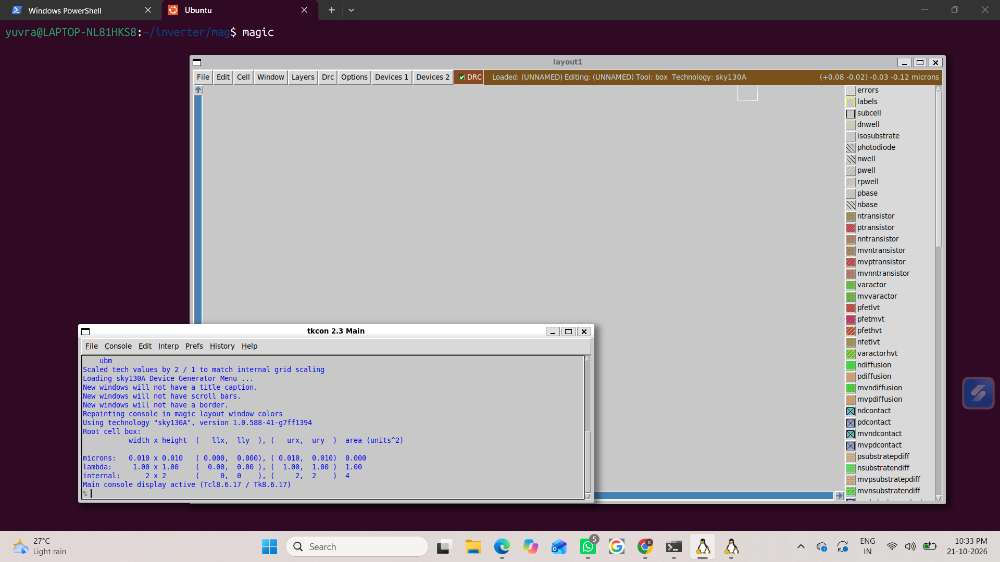
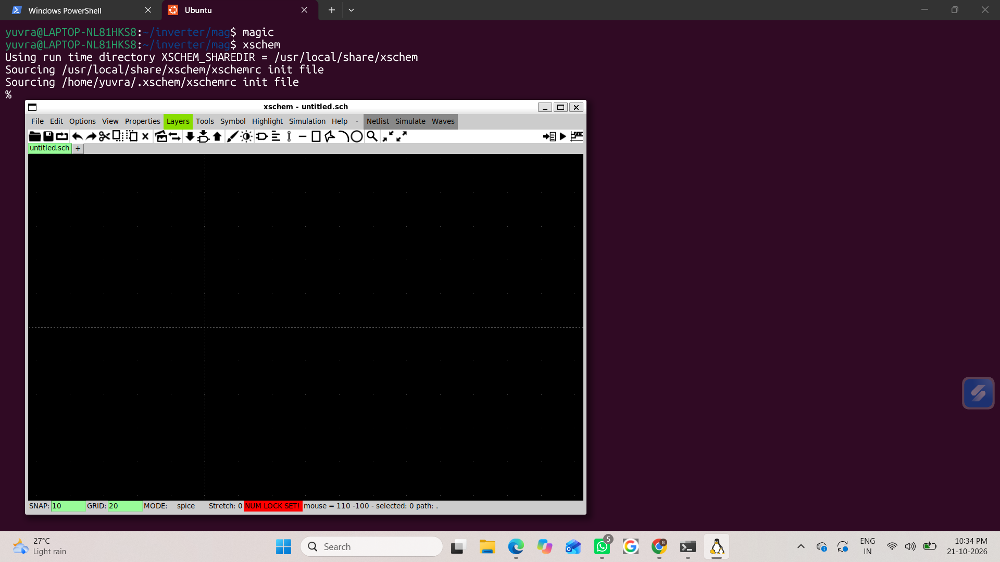
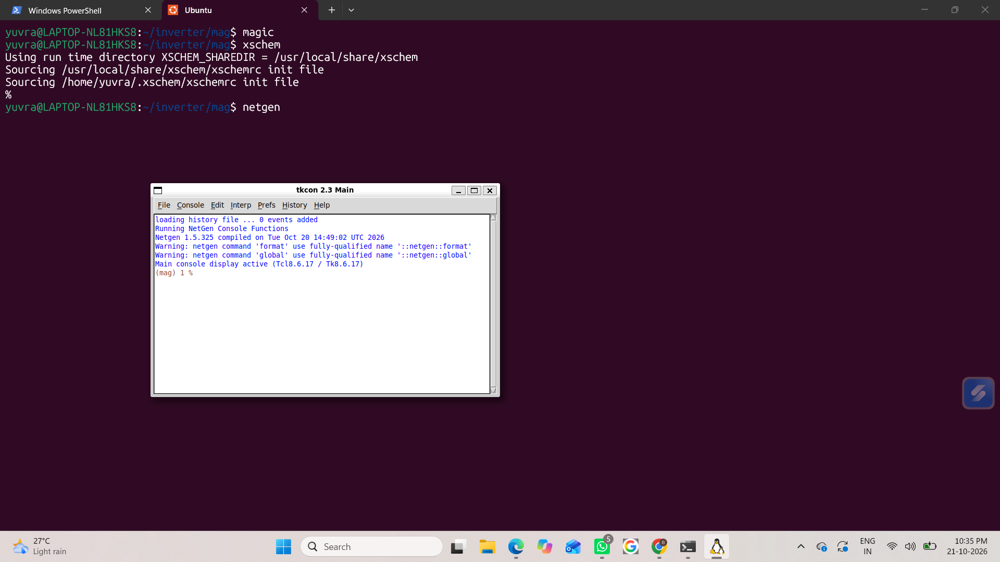
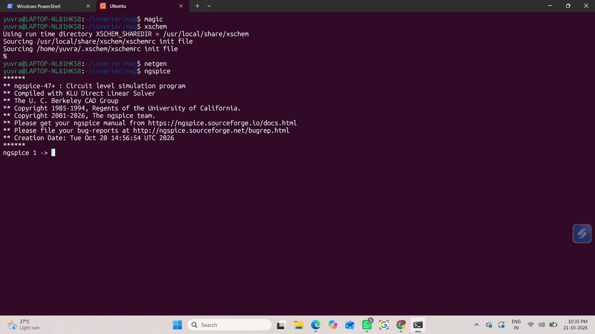
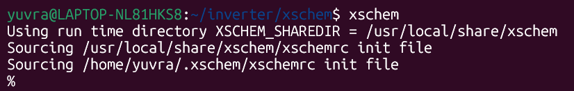
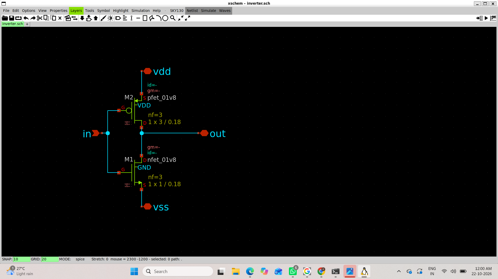

# Physical Verification Using SKY130 PDK

This repository documents the setup and verification of the open-source EDA toolflow (Magic, Netgen, Xschem, Ngspice) and the SkyWater 130nm PDK for the VSD physical verification workshop.

## 1. Tool Setup & Verification

### A. Magic (VLSI Layout Tool)
- Technology: `sky130A` loaded via `.magicrc`
- Command: `magic -d XR -T sky130A`

### B. Xschem (Schematic Capture)
- Command: `xschem`
- Verified Sky130 initialization and schematic canvas:

### C. Netgen (LVS Tool)
- Command: `netgen`
- Verified Netgen console initialization:

### D. Ngspice (Circuit Simulator)
- Command: `ngspice`
- Verified Ngspice prompt:

## 2. Directory Structure
inverter/
├── mag/        # Layout files and .magicrc -> sky130A.magicrc
├── xschem/     # Schematics, symbol libraries, and xschemrc
└── netgen/     # LVS setup scripts and setup.tcl -> sky130A_setup.tcl

### Inverter Schematic Design (Xschem)

1. **Xschem Initialization with Sky130 PDK**:
   Launched Xschem from the project directory sourcing the local `xschemrc` initialization:
   
   

2. **Completed Inverter Schematic (`inverter.sch`)**:
   - **PFET (`pfet_01v8`)**: $W/L = 3\,\mu\text{m} / 0.18\,\mu\text{m}$, $\text{nf} = 3$
   - **NFET (`nfet_01v8`)**: $W/L = 1\,\mu\text{m} / 0.18\,\mu\text{m}$, $\text{nf} = 3$
   - Terminals labeled: `in`, `out`, `vdd`, `vss`

   
